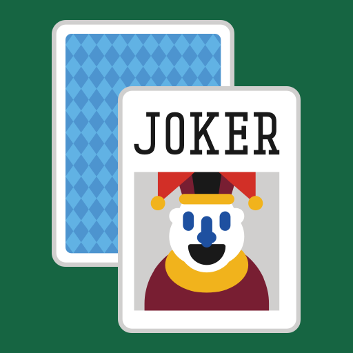
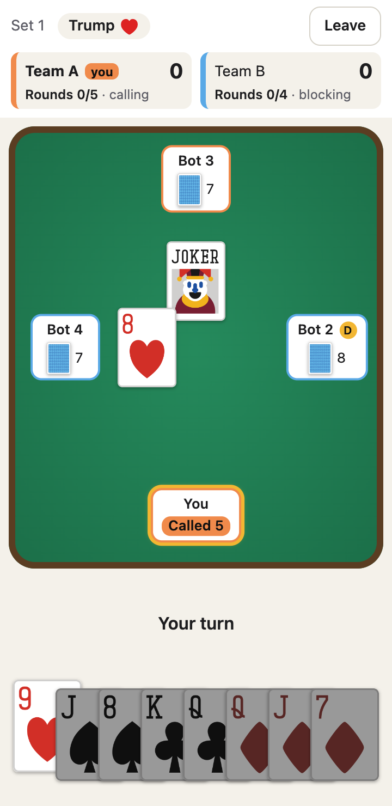

<a name="readme-top"></a>

[![Deploy][deploy-shield]][deploy-url]
[![Issues][issues-shield]][issues-url]
[![License][license-shield]][license-url]

<br />
<div align="center">
  <a href="https://github.com/mind-matrix/lorris">
    
  </a>

  <h3 align="center">Lorris</h3>

  <p align="center">
    The game of big promises and bigger comebacks.
    <br />
    <br />
    <a href="https://mind-matrix.github.io/lorris/"><strong>Play now »</strong></a>
    ·
    <a href="https://github.com/mind-matrix/lorris/issues">Report Bug</a>
    ·
    <a href="https://github.com/mind-matrix/lorris/issues">Request Feature</a>
  </p>
</div>

<details>
  <summary>Table of Contents</summary>
  <ol>
    <li><a href="#about-the-project">About The Project</a></li>
    <li><a href="#how-to-play">How to Play</a></li>
    <li><a href="#built-with">Built With</a></li>
    <li><a href="#getting-started">Getting Started</a></li>
    <li><a href="#project-structure">Project Structure</a></li>
    <li><a href="#deployment">Deployment</a></li>
    <li><a href="#roadmap">Roadmap</a></li>
    <li><a href="#license">License</a></li>
  </ol>
</details>

## About The Project

<div align="center">
  
</div>

Lorris is a team game: you and your teammates win or lose together, but you can never see each other's cards or talk
about them. You read your partners through the cards they play.

- **4 or 6 players**, with any mix of humans and bots (pass-and-play when several humans share a device)
- **Works offline** and installs as an app (PWA)
- **Mobile first**: portrait layout from 360px wide, large tap targets, light and dark mode, reduced-motion support
- **Fair bots**: bots see exactly what a human in their seat would see, nothing more
- **Tiny**: around 30 KB of gzipped JavaScript, one 128 KB card sprite sheet, no runtime dependencies besides Svelte

<p align="right">(<a href="#readme-top">back to top</a>)</p>

## How to Play

**Teams and cards.** Two teams; teammates sit in alternating seats and play goes anti-clockwise. With 4 players the
deck is 7 through Ace of every suit; with 6 players it's 3 through Ace. Either way, the lowest Spade is swapped for the
**Joker**. Everyone gets 8 cards, and a Set is played over up to 8 rounds.

**Make your call.** Each player in turn calls how many of the 8 rounds their team will win (at least 4, each call
higher than the last, up to 8) or passes. If everyone passes, the first player must call 4. The highest caller picks
the **Trump suit**.

**Play the rounds.** Follow the suit that was led if you can; otherwise play anything, including a Trump. The highest
Trump wins the round, or the highest card of the led suit if no Trump was played. The winner leads the next round.

**The Joker** beats everything and may be played at any time. If it's led, everyone must play a Trump if they have
one. If one team holds every Trump and the Joker, the cards are re-dealt.

**Scoring.** The calling team scores its call if it wins that many rounds, and loses it if it doesn't (double the first
time a team fails). The other team never scores directly. The Set ends as soon as the result is decided. First team
to **32 points** wins.

The full rules are in the game under **How to Play**.

<p align="right">(<a href="#readme-top">back to top</a>)</p>

## Built With

* [![Svelte][Svelte.dev]][Svelte-url]
* [![TypeScript][TypeScript.org]][TypeScript-url]
* [![Vite][Vite.dev]][Vite-url]
* [![Vitest][Vitest.dev]][Vitest-url]
* [vite-plugin-pwa](https://vite-pwa-org.netlify.app/) for the service worker and app manifest

No game engine: cards are DOM elements drawn from a sprite sheet and animated with CSS.

<p align="right">(<a href="#readme-top">back to top</a>)</p>

## Getting Started

### Prerequisites

* Node.js 18 or newer (CI uses Node 20)

### Installation and scripts

```sh
git clone https://github.com/mind-matrix/lorris.git
cd lorris
npm install
```

| Command | What it does |
|---|---|
| `npm start` | Start the dev server at http://localhost:5173 |
| `npm run build` | Minified production build in `dist/` |
| `npm run preview` | Serve the production build locally |
| `npm test` | Run all tests, including a 1,000-game bot simulation |
| `npm run check` | Type-check TypeScript and Svelte |
| `npm run assets` | Rebuild the card sprite sheet and app icons from `assets/` |

<p align="right">(<a href="#readme-top">back to top</a>)</p>

## Project Structure

```
assets/            source card art (one PNG per card, plus the card back)
public/icons/      generated app icons
scripts/           build-assets.mjs: dependency-free sprite sheet and icon generator
src/
  core/            rules engine: pure TypeScript, no DOM, no network, seeded RNG
  ai/              bots (RandomBot, HeuristicBot) and the headless game runner
  session/         GameHost (holds the full state) and LocalSession (offline play with bots)
  net/             interfaces for future peer-to-peer play
  ui/              Svelte components
```

How it fits together:

- **The game state is plain, serializable data.** Every change goes through one pure function,
  `applyAction(state, seat, action)`, which returns the new state or a typed rule error.
- **Nobody but the host sees the full state.** The UI and the bots only ever receive a *player view*: their own hand,
  card counts for everyone else, and the public table. This is what will make host-authoritative peer-to-peer play
  possible later.
- **Games are reproducible.** Shuffling uses a seeded RNG stored in the state, so a seed plus a list of actions
  replays a game exactly.

<p align="right">(<a href="#readme-top">back to top</a>)</p>

## Deployment

Every push to `master` runs [`.github/workflows/deploy.yml`](.github/workflows/deploy.yml), which type-checks, runs the
tests, builds with the repository name as the base path, and publishes `dist/` to GitHub Pages at
**https://mind-matrix.github.io/lorris/**. It can also be run by hand from the Actions tab.

To build for a different sub-path locally, set `BASE_PATH`:

```sh
BASE_PATH=/lorris/ npm run build
```

### Network relays (TURN)

Online games connect players directly with WebRTC. Some networks, mobile carriers especially,
block direct connections; a TURN relay passes the traffic along for those players. WebRTC still
prefers a direct connection whenever one works, so relays are only used when needed. Two relays
are supported, both optional; if one is down or out of quota, the other still works:

| Variable | What it is |
|---|---|
| `VITE_METERED_APP` | [Open Relay by Metered](https://www.metered.ca/tools/openrelay/): your subdomain only (`lorris` for `lorris.metered.live`) |
| `VITE_METERED_API_KEY` | Metered API key; TURN credentials are fetched with it at runtime |
| `VITE_TURN_URLS` | Your own coturn relay: comma-separated `turn:`/`turns:` URLs |
| `VITE_TURN_USERNAME` | Your relay's username |
| `VITE_TURN_CREDENTIAL` | Your relay's password |

- **GitHub Pages:** add them under the repository's *Settings → Secrets and variables → Actions*
  as repository secrets with exactly these names. The deploy workflow passes them to the build,
  and `scripts/check-relay-build.mjs` fails the deploy if a relay is half-configured or a value
  didn't make it into the build.
- **Local builds:** copy `.env.example` to `.env.local` (git-ignored) and fill it in.
- Leave a relay's variables empty to not use it.

> **These values are public.** They're built into the app, so anyone who opens it can read
> them. That's unavoidable without a backend. We rely on the relays' quotas, and rotate the
> credentials if they're abused.

<p align="right">(<a href="#readme-top">back to top</a>)</p>

## Roadmap

- [x] Rules engine with full test coverage for 4 and 6 players
- [x] Random and heuristic bots
- [x] Mobile-first UI, offline PWA
- [ ] Online play, peer-to-peer over WebRTC (Trystero), host-authoritative
- [ ] Stronger bot (ISMCTS)
- [ ] Android and iOS apps (Capacitor)

See the [open issues](https://github.com/mind-matrix/lorris/issues) for proposed features and known issues.

<p align="right">(<a href="#readme-top">back to top</a>)</p>

## License

See `LICENSE.txt` for more information.

<p align="right">(<a href="#readme-top">back to top</a>)</p>

<!-- MARKDOWN LINKS & IMAGES -->
[deploy-shield]: https://img.shields.io/github/actions/workflow/status/mind-matrix/lorris/deploy.yml?branch=master&style=for-the-badge&label=deploy
[deploy-url]: https://github.com/mind-matrix/lorris/actions/workflows/deploy.yml
[issues-shield]: https://img.shields.io/github/issues/mind-matrix/lorris.svg?style=for-the-badge
[issues-url]: https://github.com/mind-matrix/lorris/issues
[license-shield]: https://img.shields.io/github/license/mind-matrix/lorris.svg?style=for-the-badge
[license-url]: https://github.com/mind-matrix/lorris/blob/master/LICENSE.txt
[Svelte.dev]: https://img.shields.io/badge/Svelte-4A4A55?style=for-the-badge&logo=svelte&logoColor=FF3E00
[Svelte-url]: https://svelte.dev/
[TypeScript.org]: https://img.shields.io/badge/TypeScript-3178C6?style=for-the-badge&logo=typescript&logoColor=white
[TypeScript-url]: https://www.typescriptlang.org/
[Vite.dev]: https://img.shields.io/badge/Vite-646CFF?style=for-the-badge&logo=vite&logoColor=white
[Vite-url]: https://vite.dev/
[Vitest.dev]: https://img.shields.io/badge/Vitest-6E9F18?style=for-the-badge&logo=vitest&logoColor=white
[Vitest-url]: https://vitest.dev/
